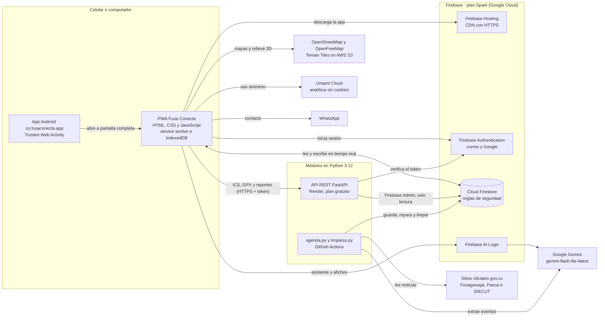
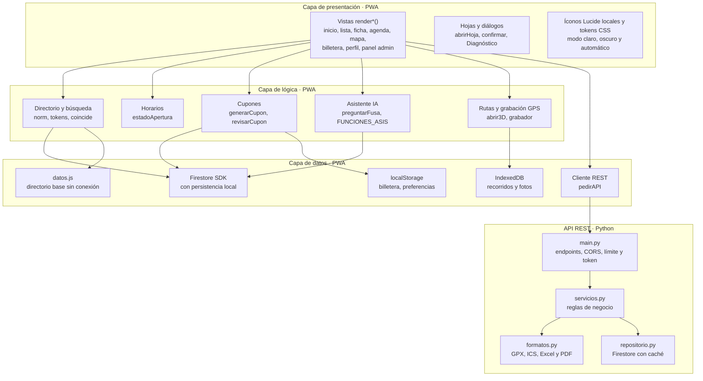
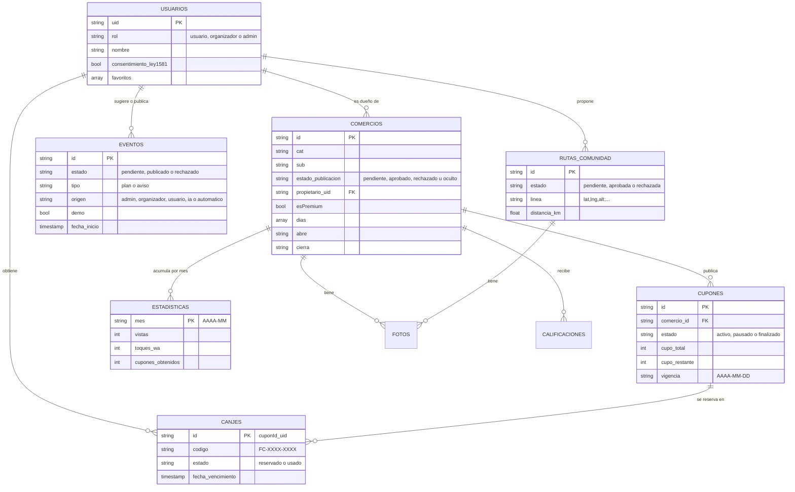
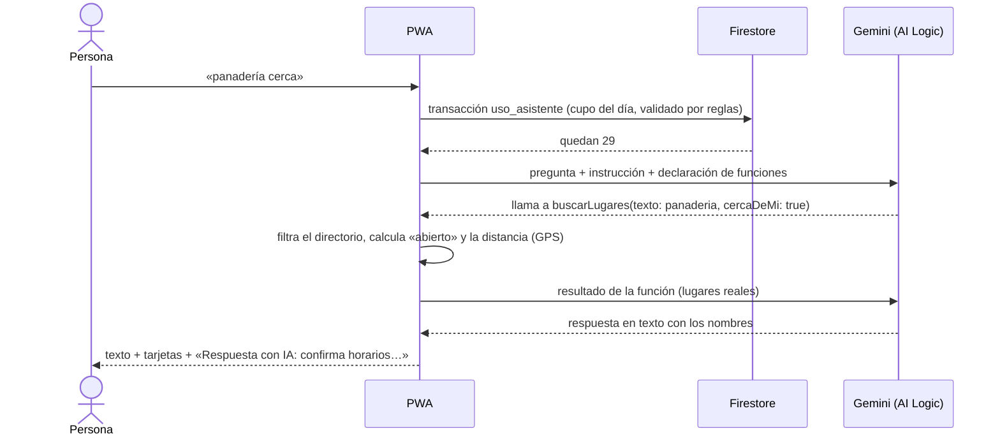
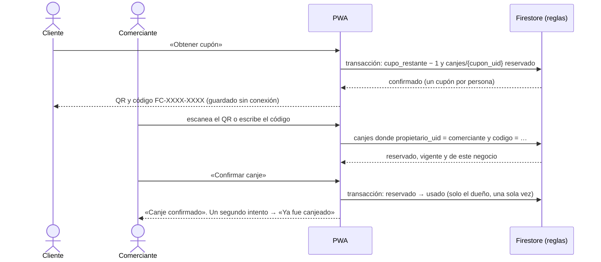
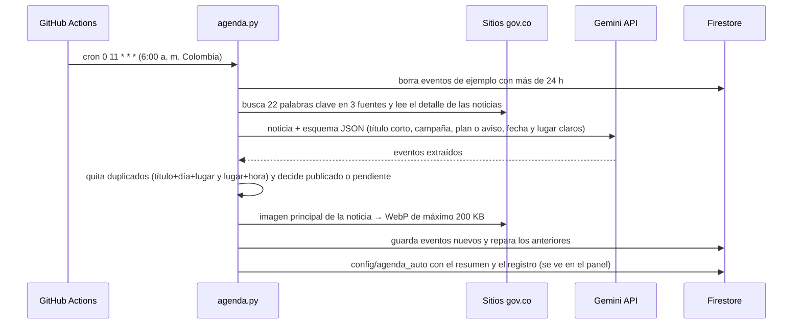
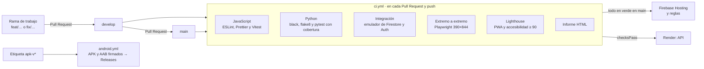

# Arquitectura de Fusa Conecta (actualizada a la v1.1.0)

GitHub dibuja los diagramas al abrir este archivo. Para pegarlos en el documento técnico, ábrelos en https://mermaid.live
(pega el bloque) y exporta a PNG o SVG.

## 1. Contexto y despliegue

Hay un solo código de app (la PWA), que la gente usa en el navegador o instalada; en Android, también como app de Google
Play (TWA). Los datos y la seguridad viven en Firebase. Los procesos en Python (API REST y automatizaciones) corren en
servicios gratuitos.

| Nodo | Tecnología | Costo |
|---|---|---|
| Dispositivo | Navegador moderno o Android 7+ (TWA) | — |
| Firebase Hosting, Auth, Firestore y AI Logic | Google Cloud, plan Spark | $0 |
| API REST | Render, plan gratuito (750 h/mes) | $0 |
| Procesos automáticos e integración continua | GitHub Actions (repositorio público) | $0 |
| Gemini | Cuota gratuita de la API y de AI Logic | $0 |
| Analítica | Umami Cloud, plan gratuito | $0 |

## 2. Capas y componentes

La PWA está organizada **en capas**, sin framework: un solo `app.js` dividido en secciones con un estado global
(`estado`) y funciones de vista `render*()`. La API sigue el mismo esquema en Python, con capas separadas en archivos.

### Patrones de diseño que sí se usan

| Patrón | Dónde | Para qué |
|---|---|---|
| **Singleton** | `firebase.initializeApp` y `db`/`auth` únicos en `app.js`; `iniciar_firebase()` y `repositorio()` en la API | Una sola conexión a Firebase por app o proceso |
| **Repository** | `api/app/repositorio.py` (`Repositorio` como `Protocol`, `RepositorioFirestore`); `IDB` en la PWA | Separar las reglas de negocio de la fuente de datos; las pruebas usan un repositorio falso |
| **Caché** (proxy) | `_Cache` de la API (2 min); service worker (red primero y copia guardada) | Cuidar la cuota de lecturas del plan Spark; funcionar sin conexión |
| **Strategy** | Funciones de `FUNCIONES_ASIS` que el modelo de IA elige | El asistente decide qué consulta hacer sin código fijo por pregunta |
| **Observer** | `onSnapshot` de Firestore (comercios, eventos, cupones, rutas) | La interfaz se actualiza sola cuando cambian los datos |
| **Inyección de dependencias** | `Depends(repositorio)` y `Depends(usuario_actual)` en FastAPI | Probar la API con datos falsos y con el emulador |

## 3. Modelo de datos (Cloud Firestore)

Base NoSQL de documentos. Toda la seguridad está en `firestore.rules`: lectura pública solo de lo publicado; escritura
según el rol (persona, comerciante dueño, organizador o admin) y con validación de campos, tamaños y transiciones de estado.

Otras colecciones:
- **Contenido:** `banners`, `notificaciones` (Novedades), `emergencias` (números editados por el admin), `opiniones`, `reportes`, `solicitudes` (Premium y reclamos) e `invitaciones` (organizadores).
- **Límites diarios de IA:** `uso_asistente` y `uso_ia`, validados en las reglas.
- **Trazados oficiales:** `rutas_oficiales`.
- **Configuración y resúmenes:** `config/agenda_auto`, `config/limpieza` y `config/directorio`.

**Sin conexión:**
- `datos.js`: directorio base y números de emergencia.
- Persistencia de Firestore en IndexedDB.
- `fusa-recorridos`: recorridos GPS y fotos, en IndexedDB.
- `localStorage`: billetera de cupones.

## 4. Secuencias críticas

### 4.1 Asistente con llamadas a funciones

### 4.2 Canje de un cupón con QR

### 4.3 Agenda automática (todos los días, 6:00 a. m.)

## 5. Integración y despliegue continuos

